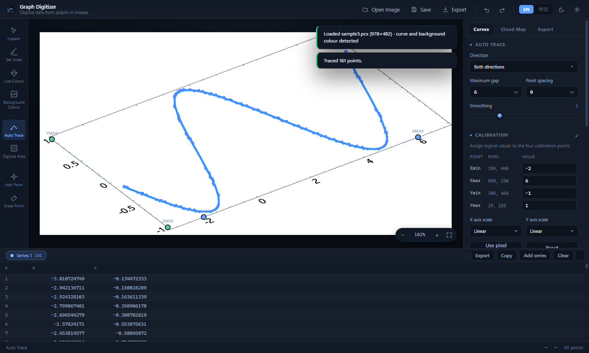
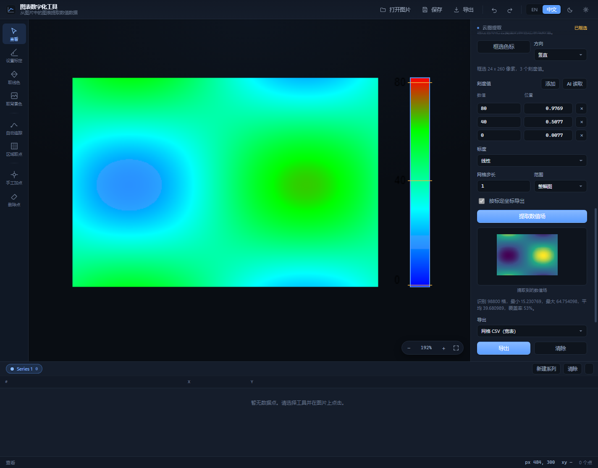
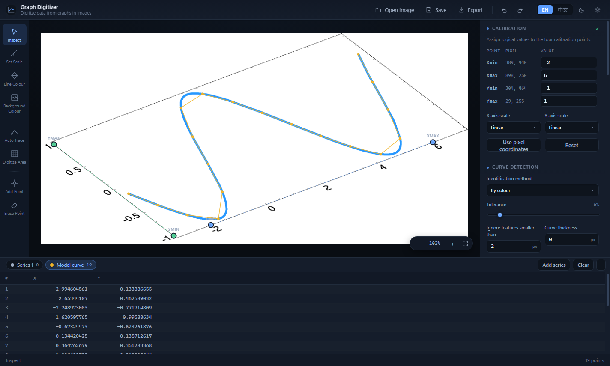
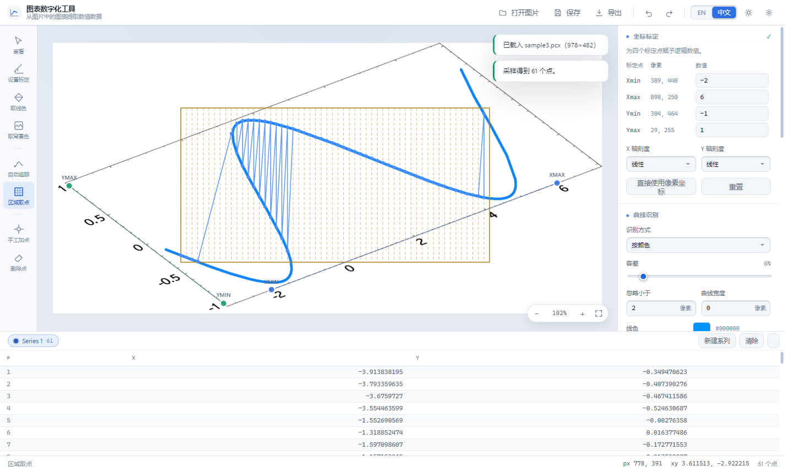
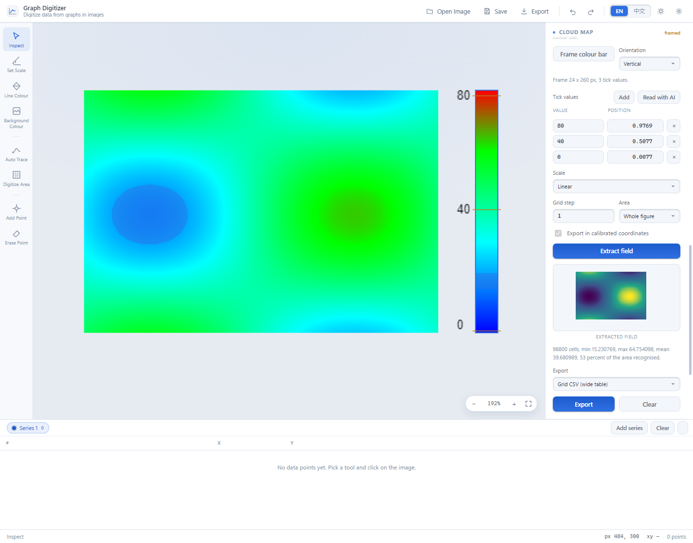
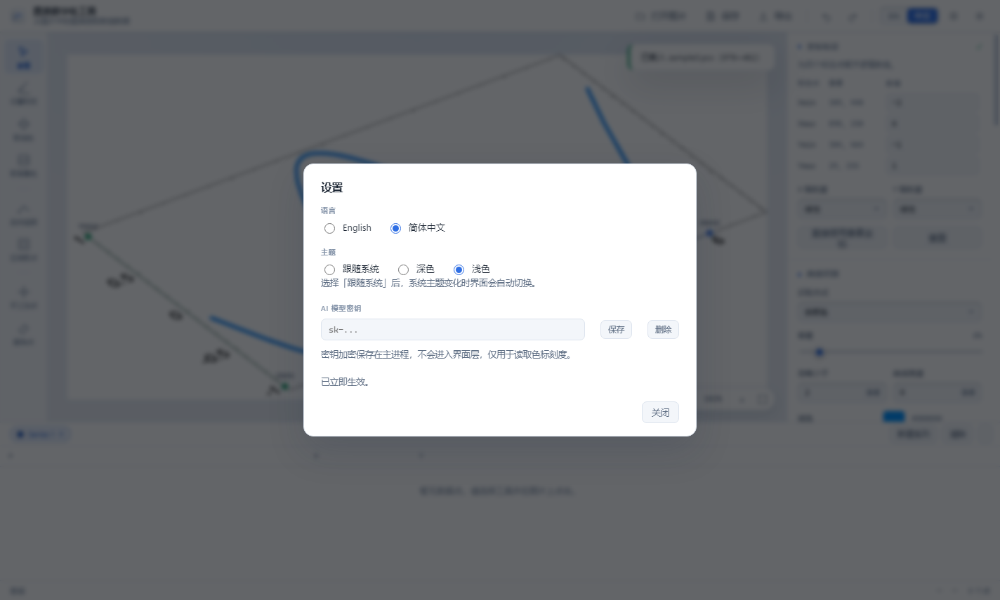

# Graph Digitizer · 图表数字化工具

把图片里的曲线变成可用的数据表，把云图里的颜色变成数值。Windows 桌面应用（Electron），界面中英双语可随时切换。

> A Windows desktop application that turns curves inside images into real data
> tables, and the colours of a contour map into numbers. Four point calibration,
> automatic line tracing, area sampling and colour bar extraction, with export
> to eight formats.



| | | |
|---|---|---|
|  |  |  |
| **自动追踪**：沿曲线取点，直接进数据表 | **云图提取**：框选色标 → 读出刻度 → 还原整幅图的数值 | **AI 提取曲线**：模型读出曲线，作为新系列加入 |

| | | |
|---|---|---|
|  |  |  |
| **区域取点**：矩形网格采样，适合虚线 | 同一功能的浅色主题 | **设置**：语言 / 主题 / AI 密钥 |

---

## 能做什么 · What it does

### 曲线数字化

从截图或扫描件里把曲线上的点取出来，变成能直接进 Excel / Origin 的数据表。

- **自动追踪**：点一下曲线起点，程序沿曲线走，交叉点会直行穿过，虚线会跨过断点
- **区域取点**：拖一个矩形，程序在区域内按网格采样并与曲线求交——虚线、任意形状、地图线条都适用
- **手工补点**：加点、删点，逐点微调
- **多条系列**：一张图里可以分几套数据，各自有名字和颜色

### 四点标定

在图上点四个点（Xmin / Xmax / Ymin / Ymax），填上真实数值，所有取出来的点就都带上了逻辑坐标。

- **两轴不必垂直，也不必与图像边缘平行**——程序按两条轴向量构建仿射变换，倾斜的坐标系、三维旋转投影出来的图都能处理
- X 轴 / Y 轴各自可选线性或对数刻度
- 不想标定就用像素坐标（数据表里是像素值）

### 云图提取

折线图只有一条曲线，云图（等值线填色图）却是**一整片连续数值场**——颜色本身就是数据。云图有独立的 `云图提取` 页签和独立的导出，不跟折线图的数据表混在一起。

- **框选色标 → 读出刻度 → 提取数值场**，颜色不再是颜色，而是数字
- **刻度值两种来源**：视觉模型自动读，或手填，两种可以混用，模型读不准的直接改
- **三种导出**：网格 CSV（宽表，Excel/Origin 直接画等值线）、点表 CSV（X, Y, 数值）、数值场 PNG

### AI 读图

- **读色标刻度**：视觉模型读出色标标签上的数字和位置
- **读曲线**：模型读出图里的曲线，作为新系列直接进数据表

两条路走的是同一个通道、同一个密钥。密钥用 `safeStorage` 加密后存在主进程，**永远不会进入界面层**，应用也不联网做别的事。

### 导出

**CSV / TXT / Excel(XML) / XML / JSON / SVG 图表 / AutoCAD DXF / PostScript EPS**，外加一键复制到剪贴板。

`Save` 保存工作区（`.gdw`，JSON 格式，含标定、系列、采样参数），下次打开接着干。

### 其它

- **界面中英双语**，主题**默认跟随系统**，三处入口任选其一
- **数据表可排序、可双击编辑、可选中删除**，与画布联动
- 滚轮缩放（以光标为中心）、`Ctrl+滚轮` 精细缩放、空格+拖动平移
- 底部数据表可折叠

---

## 快速开始 · Quick start

**方式一：免安装便携版**
下载 `GraphDigitizer-1.5.0-portable.exe`，双击即用，不写注册表、不装任何依赖。

**方式二：安装版**
运行 `GraphDigitizer-1.5.0-x64.exe`，可自选安装目录，自动创建桌面与开始菜单快捷方式。

**方式三：从源码运行**

```bash
npm install
npm start
```

---

## 用法 · How to use it

### 1. 打开图片 — Open Image

拖放或点击 `打开图片`（Ctrl+O）。支持 PNG / JPG / BMP / GIF / WEBP。

> TIFF 暂不支持：Electron 内置的 Chromium 没有 TIFF 解码器。与其让你选一个打不开的文件，不如现在就说清楚。

打开之后程序会**自动识别曲线色和背景色**，识别结果直接画成半透明掩膜叠在图上——一眼就能看出准不准。认错了就用工具栏的 `取线色`（L）和 `取背景色`（B）各点一下重新采样，或者在 `曲线识别` 面板里手动填。

### 2. 设置标定 — Set Scale（快捷键 `S`）

依次在图上点四个点：**Xmin → Xmax → Ymin → Ymax**，然后在右侧面板给每个点填入真实数值。

| 标定点 | 含义 |
|---|---|
| `Xmin` | X 轴的起点，填该位置对应的逻辑 X 值 |
| `Xmax` | X 轴的终点，填该位置对应的逻辑 X 值 |
| `Ymin` | Y 轴的起点，填该位置对应的逻辑 Y 值 |
| `Ymax` | Y 轴的终点，填该位置对应的逻辑 Y 值 |

X 轴或 Y 轴选 `Logarithmic` 即为对数刻度（两个端点值都必须大于 0）。

**不想标定？** 点 `直接使用像素坐标` 就行。

### 3. 取点 — Digitize

**A. 自动追踪（`T`）** —— 适合实线

点一下曲线起点，程序沿曲线追踪。遇到交叉点时优先走直线方向。
参数：`最大断点距离`（允许跨越的最大断点，虚线要用）、`平滑`、`取点间距`（0 = 逐像素）。

**B. 区域取点（`G`）** —— 适合虚线、任意形状

在图上拖出一个矩形区域，程序在区域内生成采样线并与曲线求交。
参数：`网格`（`像素` / `逻辑 X` / `逻辑 Y`）、`间距` / `偏移`、`取点位置`（`曲线中线` / `区域边界`）、`旋转`（斜曲线用它）。

**C. 加点（`P`）/ 删点（`E`）** —— 手工补点、删点。

**D. 用 AI 提取曲线** —— 让模型读图

点 `曲线识别` 面板里的 `用 AI 提取曲线`，视觉模型读出图里的曲线，作为**新系列**直接进数据表（归一化坐标会还原成像素位置，再按标定转成逻辑值）。


> 右侧检查器只显示**当前工具**对应的面板：选了 `自动追踪` 就显示追踪参数，选了 `区域取点` 就显示区域参数，并且排在最上面。

### 4. 导出 — Export（Ctrl+E）

数据抽屉右上角就有 `导出` 和 `复制`；导出格式、分隔符、小数位在检查器的 `导出` 页签里设置。

| 格式 | 内容 |
|---|---|
| `CSV` / `Text` | 逗号或制表符分隔的数据表 |
| `Excel (XML)` | Excel 直接打开 |
| `XML` / `JSON` | 结构化数据 |
| `SVG chart` | 把曲线画成矢量图 |
| `AutoCAD DXF` | CAD 里的曲线 |
| `PostScript EPS` | 出版插图用的矢量格式 |

`Save`（Ctrl+S）保存工作区（`.gdw`）。

---

## 云图提取 · Cloud Map

### 三步

1. **框选色标** —— 切到 `云图提取` 页签，点 `框选色标`，在图上拖一个矩形把色标（那条彩色竖条）圈住。方向可选竖直 / 水平。
2. **给刻度值** —— 两种方式，任选或混用：
   - **AI 读取**：点 `用 AI 读取`，视觉模型（MiniMax-M3）读出刻度标签上的数字和它所在的位置，自动填进刻度表。读错的直接改数字就行。**读完立刻自动提取数值场**
   - **手填**：刻度表里每一行是「数值 + 位置」。位置 `0` 是色标低端、`1` 是高端。点 `添加` 加一行。
3. **提取数值场** —— 点 `提取数值场`。程序沿色标逐行取色，建立「颜色 → 数值」映射，再把图中每个像素查表还原成数值。

面板里会给出识别到多少格、最小/最大/平均值和覆盖率，下方还有数值场的实时预览。

### 导出

| 格式 | 内容 |
|---|---|
| `网格 CSV（宽表）` | 第一行是 X 坐标，每行开头是 Y 坐标，后面是数值。Excel / Origin 直接打开就能画等值线 |
| `点表 CSV` | 长表：一行一个格子，`X, Y, 数值` |
| `数值场 PNG` | 数值场按值着色后的位图 |

勾选 `按标定坐标导出` 后，X/Y 用的是标定后的逻辑坐标而不是像素坐标（需要先做过四点标定）。

### AI 密钥

点 `用 AI 读取` 或 `用 AI 提取曲线` 需要 MiniMax 的 API key。在 **设置（Ctrl+,）** 里有 `AI model key` 一栏，填进去保存即可。


### 精度

在合成等值线图上验证：颜色还原的数值平均误差 **0.37**，最差 1.4（约两个色带宽度）。这是颜色量化方法的固有精度——色带越宽越准。真实数据建议把 `网格步长` 调大一点再看平均值。

在**真实 arXiv 论文图**上验证：误差 **0.73%–1.72%（量程百分比）**。

详细说明见 [`docs/CLOUD-MAP.md`](docs/CLOUD-MAP.md)。

---

## 界面语言与主题 · Language & theme

界面**中英双语**，主题**默认跟随系统**。三处入口，任选其一：

| 位置 | 操作 |
|---|---|
| 标题栏右上角 | `EN │ 中文` 分段开关，点一下立即切换 |
| 标题栏齿轮按钮 / `Ctrl+,` | 打开**设置**面板，里面有「语言」与「主题」两组单选 |
| 原生菜单 | `View → Language` 切语言，`View → Theme` 切主题 |

- **首次启动按操作系统语言自动判定**（中文系统 → 中文界面，英文系统 → 英文界面），选择结果会记住
- 切换**即时生效**，不用重启
- 主题三个选项：**跟随系统 / 深色 / 浅色**。默认跟随系统，Windows 切到浅色或深色，**应用会自动跟着变**（约 1 秒内）；一旦手动选了就不再跟随
- 标题栏那颗主题按钮会在 跟随系统 → 浅色 → 深色 之间循环，图标同步变化

---

## 界面说明 · Interface

```
┌──────────────────────────────────────────────────────────────────┐
│ 标题栏：打开 / 保存 / 导出 / 撤销 / 重做 / 语言 / 主题            │
├────┬─────────────────────────────────────────┬───────────────────┤
│工具│                                         │ 检查器            │
│ 栏 │              画布视口                    │ 曲线 │云图│导出   │
│    │                                         │ （当前工具的面板） │
├────┴─────────────────────────────────────────┴───────────────────┤
│ 数据表（可排序、可双击编辑、可选中删除）           导出 / 复制      │
├──────────────────────────────────────────────────────────────────┤
│ 状态栏：光标像素坐标 · 逻辑坐标 · 缩放 · 点数                       │
└──────────────────────────────────────────────────────────────────┘
```

左侧是**工具栏**，中间是**画布**，右侧是**检查器**（三个页签：曲线 / 云图提取 / 导出），底部是**数据表**。

- 滚轮缩放（以光标为中心），`Ctrl+滚轮` 精细缩放，空格+拖动平移
- 数据表与画布联动：选中表格行，画布上对应点高亮
- 底部数据表可折叠

---

## 键盘快捷键 · Keyboard shortcuts

| 键 | 功能 |
|---|---|
| `V` `S` `L` `B` `T` `G` `P` `E` | 查看 / 标定 / 取线色 / 取背景色 / 自动追踪 / 区域取点 / 加点 / 删点 |
| `Space` + 拖动 | 平移画布 |
| 滚轮 / `Ctrl+滚轮` | 缩放 / 精细缩放 |
| `F` · `Ctrl+0` · `Ctrl+1` | 适应窗口 / 适应窗口 / 实际大小 |
| `Ctrl+Z` · `Ctrl+Y` | 撤销 / 重做 |
| `Delete` | 删除选中的点 |
| `Ctrl+O` `Ctrl+S` `Ctrl+E` `Ctrl+C` | 打开 / 保存 / 导出 / 复制 |
| `Ctrl+M` | 显示或隐藏识别掩膜 |
| `Esc` | 取消当前操作 |

---

## 算法说明 · How it works

**标定**：由 Xmin→Xmax 和 Ymin→Ymax 两条轴向量构建仿射变换。

```
u = ((p − Xmin) · ax) / (ax · ax)     → X 轴归一化位置
v = ((p − Ymin) · ay) / (ay · ay)     → Y 轴归一化位置
X = interp(xminValue, xmaxValue, u)   （对数轴时在 log 空间插值）
```

**曲线识别**：逐像素计算与线色/背景色的「redmean」感知色距，二值化成掩膜；支持颜色 / 灰度 / 组合三种判据，可过滤小连通域、可膨胀加粗。

**自动追踪**：在掩膜上做方向感知的 8 邻域行进。每步在邻域内选择与当前方向夹角最小的候选像素（因此交叉点处会直行穿过）；无候选时沿当前方向前瞻至多 `最大断点距离` 像素寻找断点另一侧，并约束跳跃方向与横向偏移，避免回跳振荡。最后用 Douglas-Peucker 简化并按弧长重采样。

**区域取点**：在矩形窗口（可旋转）内生成采样线，用 slab 法与窗口求交，沿线以 0.4 像素步进扫描掩膜，记录每一段命中；取点位置取命中段中点或首端（区域边界）。

**云图**：色标逐行取色 → 每个色带挂上它位置上的数值 → 图中每个像素查最近的色带 → 超出容差的颜色（图例、文字、背景）不计。色带查找用精确最近邻，不是固定查找表——长色标上一个查找表格子相当于几十像素，数值会认错带。

---

## 精度验证 · Validation

八套可执行回归，覆盖算法、模型解析、跨层一致性、主题、交互体验、安全策略、指针手势与真实论文图：

```bash
node tools/run-tests.js
```

| 脚本 | 命令 | 内容 |
|---|---|---|
| `tools/algorithm-test.js` | `node tools/algorithm-test.js` | 标定 / 掩膜 / 追踪 / 区域取点 / 导出器 / 色标，**101 项断言** |
| `tools/llm-test.js` | `node tools/llm-test.js` | 模型提示词与回复解析（离线，不联网），**34 项** |
| `tools/cross-check.js` | `node tools/cross-check.js` | i18n 键、DOM id、IPC 通道、脚本引用的一致性 |
| `tools/theme-test.js` | `electron tools/theme-test.js` | 跟随系统 / 固定主题 / 工具栏切换，**7 项** |
| `tools/experience-test.js` | `electron tools/experience-test.js` | 换图重置、标定重算、掩膜开关、系列改名、空状态引导，**6 项** |
| `tools/smoke-test.js` | `electron tools/smoke-test.js` | 真实主进程启动：`app://` 协议、CSP 拦截、测试钩子门控，**11 项** |
| `tools/ui-test.js` | `electron tools/ui-test.js` | 指针手势阈值、选中态同步、编辑后点击不丢、云图全流程，**18 项** |
| `tools/paper-test.js` | `electron tools/paper-test.js` | **真实 arXiv 论文图**上的色标提取与数值场还原，**20 项** |

论文图夹具来自 arXiv 论文 2601.00342 的源码包，`python tools/fetch_paper_figures.py` 可随时重建。

### 模型能力评测 · Benchmark

除了回归，还有一套**几百张真实论文图**上的能力评测，用来回答「模型在真实图上到底比经典算法强多少、弱多少」。

```bash
python tools/bench_fetch.py --count 400 --papers 140   # 取图
electron tools/bench-reference.js                      # 经典基准线
electron tools/bench-llm.js --task bar                # 评测（可中断续跑）
node tools/bench-report.js                            # 汇总
```

评测查出来的东西已经改了产品本身（坐标换算、刻度定位、水平色标），方法和结论见 [`docs/BENCHMARK.md`](docs/BENCHMARK.md)。

### 与 GetData 的对照

验证数据来自 GetData Graph Digitizer 2.26 自带的样例图与 `.gdw` 工作区 —— 工作区里保存了原程序自己提取的真值坐标。

| 样例 | 内容 | 结果 |
|---|---|---|
| `sample3.pcx` | 三维旋转坐标系 + 蓝色曲线 | **100% 真值点误差 ≤ 2 px，平均 0.80 px** |
| `sample1.jpg` | 地形图，1 像素宽红色公路 | 掩膜可分离，追踪受同色地形干扰 |
| `sample2.tif` | 六条同色不同线型的多系列图 | 标定管线有效；色度法无法区分同色系列（固有局限） |

标定管线在三个真实工作区上单独验证：标定有效、所有真值点映射为有限逻辑值、像素往返误差 < 1e-13 px。

---

## 目录结构 · Project layout

```
electron/          主进程（窗口、原生菜单、文件对话框 IPC）
  main.js
  preload.js       contextBridge 安全桥接
  llm.js           模型调用、密钥加密存储、提示词与解析
src/
  index.html       界面骨架
  styles.css       主题变量与全部样式（深/浅色）
  js/
    i18n.js        en / zh-CN 词典
    state.js       状态仓库 + 撤销/重做
    app.js         装配层：工具、快捷键、菜单、导入导出、云图
    core/
      geometry.js  几何工具（简化、平滑、重采样、裁剪）
      calibrate.js 四点标定（仿射 + 对数轴）
      mask.js      曲线识别掩膜
      trace.js     自动追踪
      area.js      区域采样
      colorbar.js  色标标定与数值场提取
      exporters.js 八种导出格式 + 网格 CSV
    ui/
      canvas.js    画布渲染与交互
      table.js     虚拟化数据表
tools/
  run-tests.js               跑全部八套回归
  algorithm-test.js          算法测试
  llm-test.js                模型提示词与解析测试
  cross-check.js             跨层一致性检查
  theme-test.js              主题回归
  experience-test.js         交互体验回归
  smoke-test.js              真实主进程冒烟测试
  ui-test.js                 指针手势、选中态与云图回归
  paper-test.js              真实论文图回归
  build_fixtures.py          从 GetData 样例生成真值夹具
  fetch_paper_figures.py     取真实 arXiv 论文图
  bench_fetch.py             取论文图（评测用）
  bench-reference.js         经典算法基准线
  bench-llm.js               模型评测
  bench-report.js            评测汇总
  bench-labels.js            刻度标签定位对比（不用模型）
  bench-labels-look.js       把两边的标签画到图上核对
  capture.js                 自动截图
build/icon.ico            应用图标
docs/
  CHANGELOG.md             更新记录
  BENCHMARK.md             真实论文图评测
  CLOUD-MAP.md             云图提取详解
  AUDIT-2026-10-25.md     缺陷审计与修复台账
```

## 构建 · Building

```bash
npm install
npm run dist      # 生成 NSIS 安装包 + 便携版 exe，输出到 release/
npm run pack      # 只解包目录，不生成安装包
```

环境要求：Node.js 22.19+ / 24.11+ / 26+。

## 更新记录 · Changelog

版本历史在 [`docs/CHANGELOG.md`](docs/CHANGELOG.md)。

## 许可 · License

MIT
