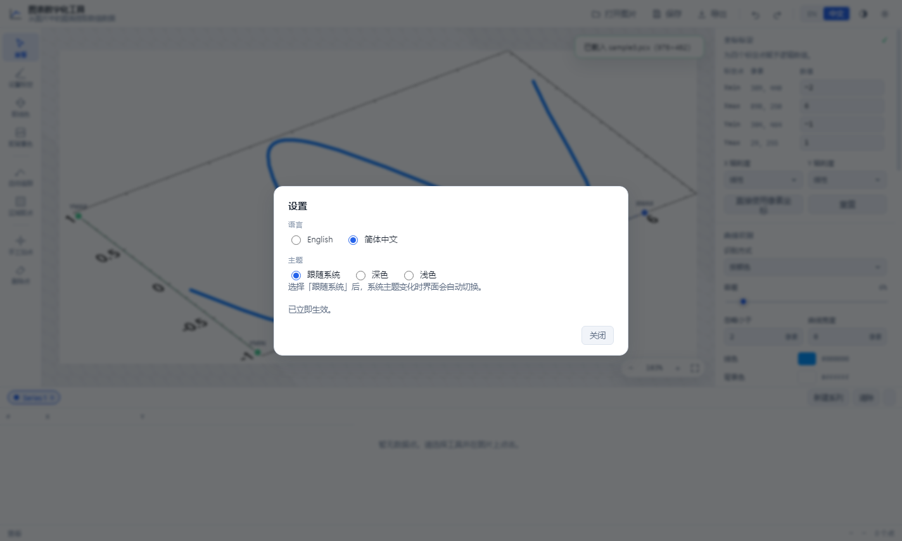
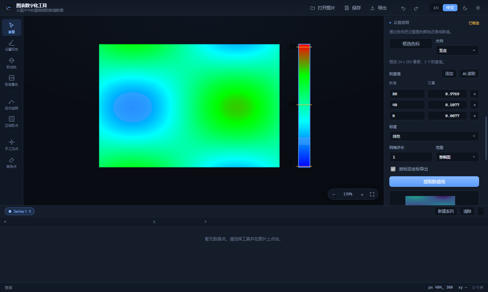

# Graph Digitizer · 图表数字化工具

把图片里的曲线变成可用的数据表。Windows 桌面应用（Electron），界面中英双语可随时切换。

> A Windows desktop application that turns curves inside images into real data
> tables. Four point calibration, automatic line tracing and area sampling,
> with export to eight formats.


| | |
|---|---|
|  |  |
| 中文界面 · 区域取点 | 设置：语言 / 主题（跟随系统） |

| | |
|---|---|
|  | |
| 云图提取 · 框选色标后读出刻度值 | |

---

## v1.3.0 更新

**新增：云图提取（Cloud Map）**

- **按色标还原云图数值**：框选色标 → 给刻度值 → 提取出整幅图的数值场。颜色不再是颜色，而是数字
- **刻度值两种来源**：AI 自动读（MiniMax-M3 视觉模型读刻度标签上的数字和位置）或手动填，两种可以混用，模型读不准的直接改
- **三种导出**：网格 CSV（宽表，Excel/Origin 直接画等值线）、点表 CSV（X, Y, 数值）、数值场 PNG
- **坐标标定与色标标定互相独立**：网格的 X/Y 可以用标定后的逻辑坐标，数值用色标
- **API key 只存在主进程**：`safeStorage` 加密，界面层拿不到也读不回

**新增：AI 提取曲线**

- `Curve Detection` 面板里多了一个 `Extract curves with AI`：模型读出图里的曲线，作为新系列直接进数据表，走的是同一条 AI 通道、同一个密钥

**回归套件扩到七套、159 项断言**，新增色标算法断言、模型解析离线断言、跨层一致性检查和云图/AI 曲线端到端断言。

说明见 [`docs/CLOUD-MAP.md`](docs/CLOUD-MAP.md)。

---

## v1.2.0 更新（缺陷修复版）

一次独立审计发现 **36 项缺陷**，本版本全部修完。最关键的几条：

- **标定模型修正**：原实现把"垂直投影"和"仿射等值线"两套不兼容的几何混着用，两轴不垂直时逻辑坐标会错乱。已统一为仿射基分解，在真实倾斜样例上曲率降低 **58 倍**，真值点 X 单调性从 77/108 恢复到 **108/108**
- **改标定后所有点自动重算**（此前点数组逐字节不变，界面看着刷新了、数字却是旧的）
- **打开新图自动清空**上一张图的标定与数据
- **渲染进程迁到自定义 `app://` 协议**，`script-src 'self'` 才真正管得住本地文件；同时删掉了没有任何调用者的 `readText` 特权通道，文件读取限定在用户打开过的目录内
- **点击/拖拽判定改用屏幕像素**：此前按图像像素算，放大 40 倍后拖 40 像素会被当成点击，缩小后抖 2 像素反而丢掉点击
- **画布与表格的选中态统一**：删掉一个点后，画布不再把"选中"色画到隔壁点上
- **原生菜单移除 `Delete` 加速键**：在标定输入框里按 Delete 想删字符，不再顺手删掉数据点
- **八种导出格式统一处理缺失测量**：不再出现 `NaN` 坐标或被伪造成 0 的数字

完整台账见 [`docs/AUDIT-2026-10-25.md`](docs/AUDIT-2026-10-25.md) 的「修复台账」一节。

---

## v1.1.0 更新

- **界面全面重做**：统一设计 token、深浅双主题重新调校、数据表重做（数值右对齐 + 等宽数字 + 斑马纹）、空状态重做并加入**三步引导卡**
- **掩膜开关与透明度真正生效**（此前是死控件），叠加层在深色图上也清晰可见
- **改标定后自动重算**所有已数字化点的逻辑坐标
- **打开新图自动清空**上一张图的标定与数据，避免导出张冠李戴
- **系列重命名改用应用内弹窗**（Electron 不支持 `window.prompt`，此前永远失败）
- 不再提供 TIFF（Chromium 无 TIFF 解码器），万一拖入会给出明确提示

完整改动清单见 [`docs/UX-PRIORITIES.md`](docs/UX-PRIORITIES.md)，
缺陷审计见 [`docs/AUDIT-2026-10-25.md`](docs/AUDIT-2026-10-25.md)。

---

## 快速开始 · Quick start

**方式一：免安装便携版**
下载 `GraphDigitizer-1.3.1-portable.exe`，双击即用，不写注册表、不装任何依赖。

**方式二：安装版**
运行 `GraphDigitizer-1.3.1-x64.exe`，可自选安装目录，自动创建桌面与开始菜单快捷方式。

**方式三：从源码运行**

```bash
npm install
npm start
```

---

## 界面语言与主题 · Language & theme

界面**中英双语**，主题**默认跟随系统**。三处入口，任选其一：

| 位置 | 操作 |
|---|---|
| 标题栏右上角 | `EN │ 中文` 分段开关，点一下立即切换 |
| 标题栏齿轮按钮 / `Ctrl+,` | 打开**设置**面板，里面有「语言」与「主题」两组单选 |
| 原生菜单 | `View → Language` 切语言，`View → Theme` 切主题 |

### 语言
- **首次启动按操作系统语言自动判定**（中文系统 → 中文界面，英文系统 → 英文界面）
- 选择结果会记住，下次启动沿用
- 切换**即时生效**，不用重启

### 主题
- 三个选项：**跟随系统 / 深色 / 浅色**
- 默认「跟随系统」——Windows 切到浅色或深色，**应用会自动跟着变**（约 1 秒内）
- 一旦手动选了「深色」或「浅色」，就不再跟随系统，钉住你的选择
- 标题栏那颗主题按钮会在 跟随系统 → 浅色 → 深色 之间循环，图标同步变化
- 主题切换时，Electron 原生标题栏的配色也会跟着变（深色时深底浅图标）

---

## 五个步骤，把图变成数据 · The five steps

### 1. 打开图片 — Open Image
拖放或点击 `Open Image`（Ctrl+O）。支持 PNG / JPG / BMP / GIF / WEBP。

> TIFF 暂不支持：Electron 内置的 Chromium 没有 TIFF 解码器。与其让你选一个打不开的文件，不如现在就说清楚。

### 2. 设置标定 — Set Scale（快捷键 `S`）
依次在图上点四个点：**Xmin → Xmax → Ymin → Ymax**，然后在右侧面板给每个点填入真实数值。

这四点的定义：

| 标定点 | 含义 |
|---|---|
| `Xmin` | X 轴的起点，填该位置对应的逻辑 X 值 |
| `Xmax` | X 轴的终点，填该位置对应的逻辑 X 值 |
| `Ymin` | Y 轴的起点，填该位置对应的逻辑 Y 值 |
| `Ymax` | Y 轴的终点，填该位置对应的逻辑 Y 值 |

**两点轴不要求垂直、也不要求与图像边缘平行** —— 程序按两条轴向量构建仿射变换，所以倾斜的坐标系、三维旋转投影出来的图都能处理。

X 轴或 Y 轴选 `Logarithmic` 即为对数刻度（两个端点值都必须大于 0）。

不想标定？点 `Use pixel coordinates` 直接用像素坐标。

### 3. 指定曲线颜色 — Pick Line Colour（`L` / `B`）
用 `Line Colour` 工具点一下曲线采样线色，用 `Background Colour` 点一下空白处采样背景色。
也可以点 `Auto Detect` 让程序自动猜（背景取出现最多的颜色，线色取与背景差异最大的主色）。

右侧 `Curve Detection` 面板可调：
- **Identification method** — `By colour`（按颜色）/ `By intensity`（按灰度，适合黑白线条图）/ `Combined`（组合）
- **Tolerance** — 容差。曲线与背景色接近时调大
- **Ignore features smaller than** — 过滤掉小于 N 像素的碎点（地图、扫描件的噪点）
- **Curve thickness** — 曲线加粗 1–4 像素，扫描件里只有 1 像素宽的线时很有用
- **Show detection mask** — 把识别结果半透明叠加在原图上，所见即所得

### 4. 取点 — Digitize

**A. Auto Trace（`T`）** —— 适合实线
点一下曲线起点，程序沿曲线追踪。遇到交叉点时优先走直线方向。
参数：`Maximum gap`（允许跨越的最大断点，虚线要用）、`Smoothing`（平滑）、`Point spacing`（取点间距，0 = 逐像素）。

**B. Digitize Area（`G`）** —— 适合虚线、任意形状
在图上拖出一个矩形区域，程序在区域内生成采样线并与曲线求交。
参数：
- `Grid` — `Pixels`（图像像素网格）/ `Logical X` / `Logical Y`（按标定后的逻辑坐标等距，受标定控制）
- `Spacing` / `Offset` — 网格间距与相位
- `Point placement` — `Middle of the curve`（曲线中线）/ `Area boundary`（区域边界）
- `Rotation` — 矩形网格旋转角，斜曲线用它

**C. Add Point（`P`）/ Erase Point（`E`）** —— 手工补点、删点

### 5. 导出 — Export（Ctrl+E）
支持 **CSV / TXT / Excel(XML) / XML / JSON / SVG 图表 / AutoCAD DXF / PostScript EPS**。
`Copy` 一键把数据以制表符分隔复制到剪贴板。

`Save`（Ctrl+S）保存工作区（`.gdw`，JSON 格式，含标定、系列、采样参数）。

---

## 云图提取 · Cloud Map

折线图只有一条曲线，云图（等值线填色图）却是**一整片连续数值场**——颜色本身就是数据。所以云图有独立的 `Cloud Map` 面板和独立的导出，不跟折线图的数据表混在一起。

### 三步

1. **框选色标** —— 点 `Frame colour bar`，在图上拖一个矩形把色标（那条彩色竖条）圈住。方向可选竖直 / 水平。
2. **给刻度值** —— 两种方式，任选或混用：
   - **AI 读取**：点 `Read with AI`，视觉模型（MiniMax-M3）读出刻度标签上的数字和它所在的位置，自动填进刻度表。读错的直接改数字就行。
   - **手填**：刻度表里每一行是「数值 + 位置」。位置 `0` 是色标低端、`1` 是高端。点 `Add` 加一行。
3. **提取数值场** —— 点 `Extract field`。程序沿色标逐行取色，建立「颜色 → 数值」映射，再把图中每个像素查表还原成数值。

面板里会给出识别到多少格、最小/最大/平均值和覆盖率，下方还有数值场的实时预览。

### 导出

| 格式 | 内容 |
|---|---|
| `Grid CSV` | 宽表：第一行是 X 坐标，每行开头是 Y 坐标，后面是数值。Excel / Origin 直接打开就能画等值线 |
| `Points CSV` | 长表：一行一个格子，`X, Y, 数值` |
| `Field PNG` | 数值场按值着色后的位图 |

勾选 `按标定坐标导出` 后，X/Y 用的是标定后的逻辑坐标而不是像素坐标（需要先做过四点标定）。

### AI 密钥

点 `Read with AI` 需要 MiniMax 的 API key。在 **设置（Ctrl+,）** 里有 `AI model key` 一栏，填进去保存即可。密钥用 `safeStorage` 加密后存在主进程，**永远不会进入界面层**，应用也不联网做别的事。

### 精度

在合成等值线图上验证：颜色还原的数值平均误差 **0.37**，最差 1.4（约两个色带宽度）。这是颜色量化方法的固有精度——色带越宽越准。真实数据建议把 `Grid step` 调大一点再看平均值。

详细说明见 [`docs/CLOUD-MAP.md`](docs/CLOUD-MAP.md)。

---

## 界面说明 · Interface

```
┌──────────────────────────────────────────────────────────────────┐
│ 标题栏：打开 / 保存 / 导出 / 撤销 / 重做 / 语言 / 主题            │
├────┬─────────────────────────────────────────┬───────────────────┤
│工具│                                         │  检查器面板        │
│ 栏 │              画布视口                    │  标定/曲线识别     │
│    │                                         │  追踪/区域采样     │
│    │                                         │  导出              │
├────┴─────────────────────────────────────────┴───────────────────┤
│ 数据表（可排序、可双击编辑、可选中删除）                            │
├──────────────────────────────────────────────────────────────────┤
│ 状态栏：光标像素坐标 · 逻辑坐标 · 缩放 · 点数                       │
└──────────────────────────────────────────────────────────────────┘
```

- 滚轮缩放（以光标为中心），`Ctrl+滚轮` 精细缩放，空格+拖动平移
- 数据表与画布联动：选中表格行，画布上对应点高亮
- 底部数据表可折叠

---

## 键盘快捷键 · Keyboard shortcuts

| 键 | 功能 |
|---|---|
| `V` `S` `L` `B` `T` `G` `P` `E` | 查看 / 标定 / 取线色 / 取背景色 / 自动追踪 / 区域取点 / 加点 / 删点 |
| `Space` + 拖动 | 平移画布 |
| 滚轮 / `Ctrl+滚轮` | 缩放 / 精细缩放 |
| `F` · `Ctrl+0` · `Ctrl+1` | 适应窗口 / 适应窗口 / 实际大小 |
| `Ctrl+Z` · `Ctrl+Y` | 撤销 / 重做 |
| `Delete` | 删除选中的点 |
| `Ctrl+O` `Ctrl+S` `Ctrl+E` `Ctrl+C` | 打开 / 保存 / 导出 / 复制 |
| `Ctrl+M` | 显示或隐藏识别掩膜 |
| `Esc` | 取消当前操作 |

---

## 算法说明 · How it works

**标定**：由 Xmin→Xmax 和 Ymin→Ymax 两条轴向量构建仿射变换。

```
u = ((p − Xmin) · ax) / (ax · ax)     → X 轴归一化位置
v = ((p − Ymin) · ay) / (ay · ay)     → Y 轴归一化位置
X = interp(xminValue, xmaxValue, u)   （对数轴时在 log 空间插值）
```

**曲线识别**：逐像素计算与线色/背景色的「redmean」感知色距，二值化成掩膜；支持颜色 / 灰度 / 组合三种判据，可过滤小连通域、可膨胀加粗。

**自动追踪**：在掩膜上做方向感知的 8 邻域行进。每步在邻域内选择与当前方向夹角最小的候选像素（因此交叉点处会直行穿过）；无候选时沿当前方向前瞻至多 `Maximum gap` 像素寻找断点另一侧，并约束跳跃方向与横向偏移，避免回跳振荡。最后用 Douglas-Peucker 简化并按弧长重采样。

**区域取点**：在矩形窗口（可旋转）内生成采样线，用 slab 法与窗口求交，沿线以 0.4 像素步进扫描掩膜，记录每一段命中；取点位置取命中段中点或首端（区域边界）。

---

## 精度验证 · Validation

五套可执行回归，覆盖算法、主题、交互体验、安全策略与指针手势：

| 脚本 | 命令 | 内容 |
|---|---|---|
| `tools/algorithm-test.js` | `node tools/algorithm-test.js` | 标定 / 掩膜 / 追踪 / 区域取点 / 导出器 / 色标，**83 项断言** |
| `tools/llm-test.js` | `node tools/llm-test.js` | 模型提示词与回复解析（离线，不联网），**34 项** |
| `tools/cross-check.js` | `node tools/cross-check.js` | i18n 键、DOM id、IPC 通道、脚本引用的一致性 |
| `tools/theme-test.js` | `electron tools/theme-test.js` | 跟随系统 / 固定主题 / 工具栏切换，**7 项** |
| `tools/experience-test.js` | `electron tools/experience-test.js` | 换图重置、标定重算、掩膜开关、系列改名、空状态引导，**6 项** |
| `tools/smoke-test.js` | `electron tools/smoke-test.js` | 真实主进程启动：`app://` 协议、CSP 拦截、测试钩子门控，**11 项** |
| `tools/ui-test.js` | `electron tools/ui-test.js` | 指针手势阈值、选中态同步、编辑后点击不丢、云图全流程，**18 项** |
| `tools/paper-test.js` | `electron tools/paper-test.js` | **真实 arXiv 论文图**上的色标提取与数值场还原，**20 项** |

论文图夹具来自 arXiv 论文 2601.00342 的源码包，`python tools/fetch_paper_figures.py` 可随时重建。实测颜色读数误差 **0.73%–1.72%（量程百分比）**，覆盖 jet 与发散色标、标签只标中段等真实情况。

验证数据来自 GetData Graph Digitizer 2.26 自带的样例图与 `.gdw` 工作区 —— 工作区里保存了原程序自己提取的真值坐标。

| 样例 | 内容 | 结果 |
|---|---|---|
| `sample3.pcx` | 三维旋转坐标系 + 蓝色曲线 | **100% 真值点误差 ≤ 2 px，平均 0.80 px** |
| `sample1.jpg` | 地形图，1 像素宽红色公路 | 掩膜可分离，追踪受同色地形干扰 |
| `sample2.tif` | 六条同色不同线型的多系列图 | 标定管线有效；色度法无法区分同色系列（固有局限） |

标定管线在三个真实工作区上单独验证：标定有效、所有真值点映射为有限逻辑值、像素往返误差 < 1e-13 px。

---

## 目录结构 · Project layout

```
electron/          主进程（窗口、原生菜单、文件对话框 IPC）
  main.js
  preload.js       contextBridge 安全桥接
  llm.js           模型调用、密钥加密存储、提示词与解析
src/
  index.html       界面骨架
  styles.css       主题变量与全部样式（深/浅色）
  js/
    i18n.js        en / zh-CN 词典
    state.js       状态仓库 + 撤销/重做
    app.js         装配层：工具、快捷键、菜单、导入导出、云图
    core/
      geometry.js  几何工具（简化、平滑、重采样、裁剪）
      calibrate.js 四点标定（仿射 + 对数轴）
      mask.js      曲线识别掩膜
      trace.js     自动追踪
      area.js      区域采样
      colorbar.js  色标标定与数值场提取
      exporters.js 八种导出格式 + 网格 CSV
    ui/
      canvas.js    画布渲染与交互
      table.js     虚拟化数据表
tools/
  algorithm-test.js        算法测试（83 项断言）
  llm-test.js              模型提示词与解析测试（34 项）
  cross-check.js           跨层一致性检查
  theme-test.js            主题回归
  experience-test.js       交互体验回归
  smoke-test.js            真实主进程冒烟测试
  ui-test.js               指针手势、选中态与云图回归
  build_fixtures.py        从 GetData 样例生成真值夹具
  capture.js               自动截图
  make_icon_and_fixtures.py
build/icon.ico            应用图标
```

## 构建 · Building

```bash
npm install
npm run dist      # 生成 NSIS 安装包 + 便携版 exe，输出到 release/
npm run pack      # 只解包目录，不生成安装包
```

环境要求：Node.js 22.19+ / 24.11+ / 26+。

## 许可 · License

MIT
